# Blacken — Architecture & Design

> **Blacken** finds personal data (PII) in documents — PDFs, scans, Word files, images, text — lets a person review what was found, and produces a redacted file where that data is **actually gone**, not just covered.
>
> This document explains the whole system: what it does, how every part works, why it was built this way, what it costs, how it is measured, and where it would go next. Every number in it comes from the evaluation harness in `backend/evals/` (see `backend/evals/RESULTS.md`).

---

## Table of contents

1. [TL;DR](#1-tldr)
2. [Problem, users, goals](#2-problem-users-goals)
3. [System context](#3-system-context)
4. [Containers and deployment view](#4-containers-and-deployment-view)
5. [Tech stack and why](#5-tech-stack-and-why)
6. [Repository map](#6-repository-map)
7. [User flow](#7-user-flow)
8. [Request lifecycle](#8-request-lifecycle)
9. [Backend components](#9-backend-components)
10. [Detection engine (the AI part)](#10-detection-engine-the-ai-part)
11. [Redaction engine](#11-redaction-engine)
12. [Data model and data lifecycle](#12-data-model-and-data-lifecycle)
13. [Security and privacy](#13-security-and-privacy)
14. [Performance, memory and capacity](#14-performance-memory-and-capacity)
15. [Reliability and failure modes](#15-reliability-and-failure-modes)
16. [Observability and the quality feedback loop](#16-observability-and-the-quality-feedback-loop)
17. [Evaluation framework and results](#17-evaluation-framework-and-results)
18. [Key design decisions (ADR log)](#18-key-design-decisions-adr-log)
19. [Trade-offs at a glance](#19-trade-offs-at-a-glance)
20. [Deployment, configuration and CI](#20-deployment-configuration-and-ci)
21. [Scaling roadmap](#21-scaling-roadmap)
22. [Known limitations](#22-known-limitations)
23. [Interview guide](#23-interview-guide)
24. [Glossary](#24-glossary)

---

## 1. TL;DR

- **What:** a web app — React SPA + FastAPI service — that detects and redacts PII in PDF, scanned PDF, DOCX, image and TXT files, with a human review step in between.
- **How it detects:** a **layered ensemble** — checksum-validated pattern recognizers (SSN, Aadhaar, cards, IBAN…), **label-anchored field recognizers** ("Name:", "Employee Code:"), spaCy statistical NER, and an optional **GLiNER transformer** run on ONNX without PyTorch — followed by context-aware confidence calibration.
- **How it redacts:** format-specific redactors that **remove** the text (PDF text layer via PyMuPDF redaction, DOCX run-level rewrite including tables/headers/hyperlinks, pixel blackout + re-OCR for scans/images) and **scrub document metadata**.
- **How it's measured:** an evaluation harness over **~20,000 documents / 27,000 labelled entities** (two public benchmarks + a hand-annotated gold set) plus an **end-to-end leakage test** that renders documents to real files and checks what survives in the output.
- **Headline results:** gold-set recall **75.8% → 93.7%** at **96.5% precision**; PII left in redacted DOCX forms **74.3% → 9.2%**; false redactions on PDFs **22.8% → 1.9%**; metadata leaks **100% → 0%**.
- **Measured, not assumed:** the harness also *rejected* two plausible "improvements" (dev-fitted thresholds, 300 DPI OCR) because the data said no.
- **Constraints that shaped it:** runs on a **512 MB free-tier container** (Railway), fully local inference (no document ever sent to a third-party API), no user accounts.

---

## 2. Problem, users, goals

### The problem
- People routinely need to share documents that contain personal data: medical records, HR files, KYC forms, contracts, support logs.
- Manual redaction is slow and error-prone. Drawing a black box in a PDF editor often **leaves the text underneath** (copy-paste still works) and leaves the author's name in file metadata.
- Cloud PII APIs solve detection but require sending the sensitive document to a third party — often exactly what's not allowed.

### Users
- **Primary:** an individual or small team (HR, clinic admin, paralegal, support lead) redacting documents before sharing.
- **Secondary:** a developer integrating redaction via the HTTP API.

### Goals (in priority order)
1. **Don't leak.** A miss (leaked SSN) is far worse than a false alarm (an extra black bar). Recall is weighted above precision everywhere (F2, not F1).
2. **Actually remove data** from the output file — text layer, every DOCX part, metadata — not just visually cover it.
3. **Keep a human in the loop** for uncertain cases: show low-confidence guesses unticked, pre-tick only confident ones.
4. **Run locally and cheaply:** no paid APIs, no GPU, fits a 512 MB container.
5. **Be measurable:** every accuracy claim backed by a reproducible evaluation.

### Non-goals (deliberately out of scope)
- User accounts / SSO (an anonymous per-browser owner token is the isolation boundary — accounts are a planned extension).
- Legacy `.doc`, spreadsheets, email formats.
- Detecting credentials (passwords, API keys) and usernames — different problem, different tools.
- Multi-language detection (English-first; the stack supports adding languages).

---

## 3. System context

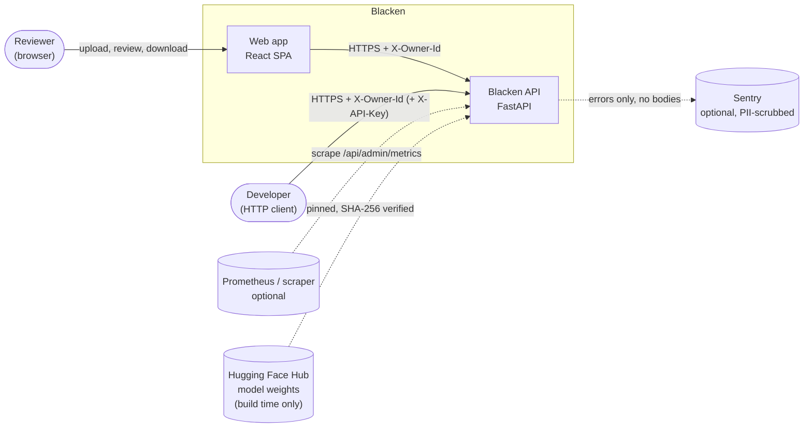

- **No document content ever leaves the API process.** Detection, OCR and redaction all run in-process.
- The Hugging Face Hub is touched **only at build time** (optional transformer weights, pinned revision + checksum).

---

## 4. Containers and deployment view

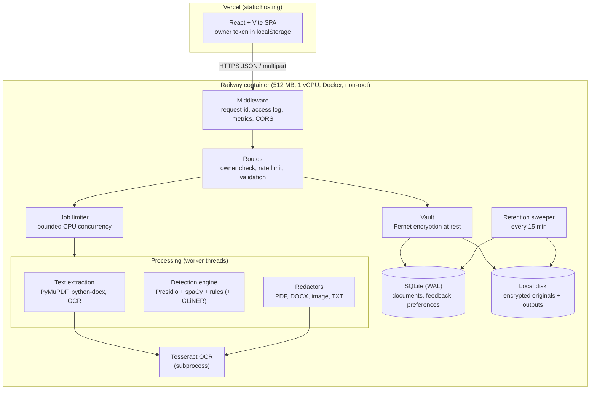

- **Single process, single instance.** All state (SQLite, files, rate-limit counters) is local — the right call for a free-tier single container; §21 covers what changes when scaling out.
- **Alternative deploy target:** a Hugging Face Space (16 GB RAM, free) via `scripts/deploy_hf_space.sh`, where the full-accuracy profile fits.

---

## 5. Tech stack and why

| Layer | Choice | Why this, not the alternative |
|---|---|---|
| Frontend | React 18 + TypeScript + Vite + Tailwind | Fast iteration, typed API contract, tiny bundle (≈92 KB gzipped JS) |
| API | FastAPI (Python 3.11/3.12) | Same language as the NLP stack; async I/O + Pydantic validation; auto OpenAPI docs |
| PII framework | **Microsoft Presidio** | MIT, local, pluggable recognizers, built-in checksum validators and context boosting. Avoids building recognizer orchestration from scratch |
| Statistical NER | **spaCy `en_core_web_lg` (vectors pruned)** | Best measured accuracy that fits memory; pruning cuts ~705 MB → ~335 MB |
| Transformer NER (optional) | **GLiNER-PII (edge)** on **onnxruntime** | PII-specific, zero-shot labels, Apache-2.0; int8 ONNX is 46 MB and needs **no PyTorch** (~700 MB saved) |
| PDF | PyMuPDF | True content removal (`apply_redactions`), word-level boxes, rasterisation |
| DOCX | python-docx | Run-level editing preserves formatting |
| OCR | Tesseract (pytesseract) | Free, local, word boxes + confidences |
| Storage | SQLite (WAL) + local disk | Zero-ops, fits one container; retention is hours, not years |
| Crypto | `cryptography` Fernet | Authenticated encryption (AES-128-CBC + HMAC-SHA256), hard to misuse |
| Hosting | Vercel (SPA) + Railway (API, Docker) | Free tiers; Railway runs the exact Dockerfile |
| CI | GitHub Actions | Runs unit, API, regression tests and the **quality gate** on every push |

---

## 6. Repository map

```
Blacken/
├── ARCHITECTURE.md                ← this document
├── frontend/                      React SPA
│   └── src/
│       ├── pages/                 Landing, Dashboard (upload→verify→preview), History, Settings
│       ├── components/            UploadSection, VerifyList, PreviewSection (page previews), ...
│       ├── hooks/use-document-redaction.ts   upload / toggle / add / redact state machine
│       └── services/api.ts        typed API client, owner token, 429/503 handling
├── backend/
│   ├── app/
│   │   ├── main.py                app factory: logging, Sentry, vault, store, engine, middleware
│   │   ├── config.py              every setting, env-driven (pydantic-settings)
│   │   ├── routes/documents.py    all /api/* endpoints
│   │   ├── security.py            magic-byte validation, rate limiter, job limiter
│   │   ├── observability.py       request IDs, access logs, Prometheus metrics, Sentry scrubbing
│   │   ├── vault.py               encryption at rest
│   │   ├── storage.py             SQLite store: documents, feedback, preferences
│   │   ├── detection/
│   │   │   ├── engine.py          Presidio orchestration + post-processing + thresholds
│   │   │   ├── recognizers.py     custom pattern + label-anchored recognizers
│   │   │   ├── gazetteers.py      non-identifying places (countries, states)
│   │   │   ├── gliner_onnx.py     GLiNER on onnxruntime (no PyTorch)
│   │   │   └── thresholds.json    per-type auto-select thresholds (fitted on dev data)
│   │   ├── extraction/text_extractor.py   PDF/DOCX/image/TXT → text (OCR fallback)
│   │   └── redaction/             matching.py, pdf_, docx_, image_, text_redactor.py
│   ├── evals/                     evaluation harness (datasets, metrics, runners, report)
│   ├── tests/                     unit, API, regression, platform, quality-gate tests
│   ├── models/en_core_web_lg_pruned/      committed pruned spaCy model
│   ├── scripts/                   build_pruned_model.py, fetch_pii_model.py
│   └── Dockerfile                 non-root image; optional PII_PROFILE=edge build arg
└── .github/workflows/backend-ci.yml
```

---

## 7. User flow

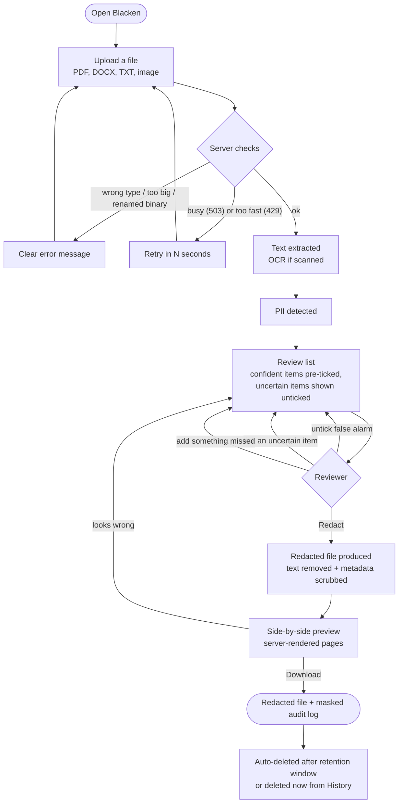

The dashboard is a four-stage state machine:

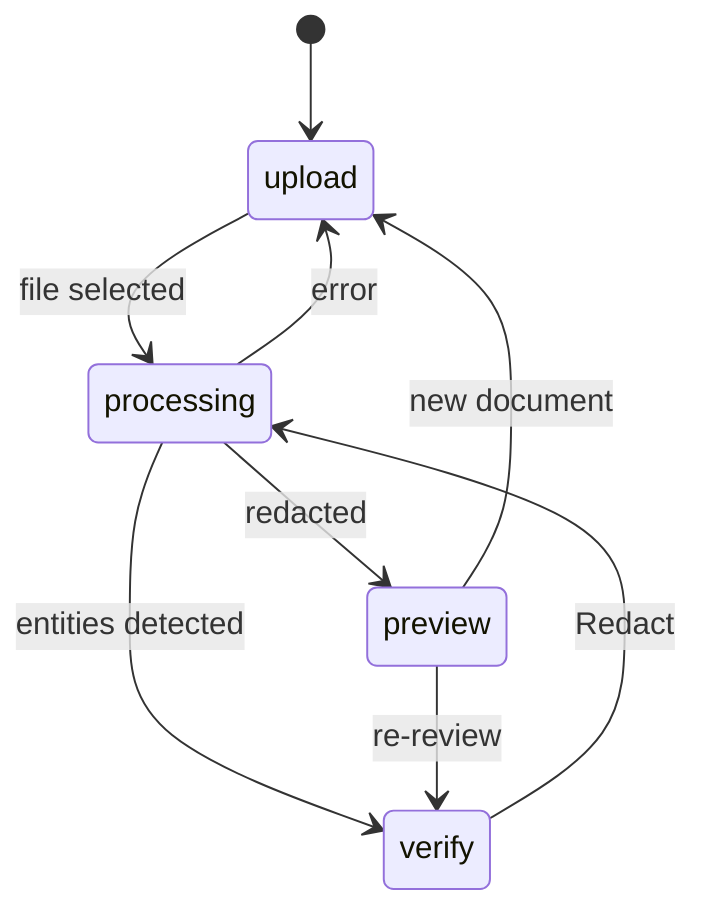

**Settings → "Your redaction rules"** lets a user keep per-browser lists:
- **Always redact** — client names, project codenames the model can't know. Every boundary-respecting occurrence is pre-ticked.
- **Never flag** — e.g. their own company name, so it stops appearing on every page.

---

## 8. Request lifecycle

### 8.1 Upload → detect

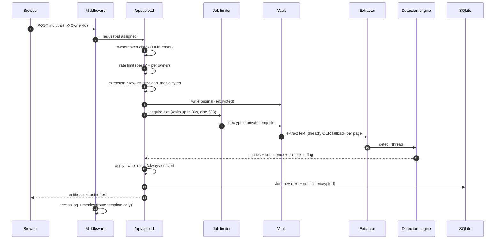

### 8.2 Review → redact → download

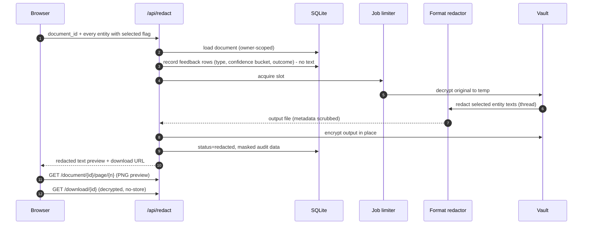

**Key properties of the pipeline**
- Heavy work (OCR, NLP, rendering) always runs in **worker threads** behind a **bounded job limiter** — the event loop keeps answering health checks and light requests.
- Plaintext exists only in a **private temp file for the duration of one job**, then is deleted.
- The browser sends back **every** entity with its tick state. That makes the redaction auditable and turns each review into a labelled data point (§16).

---

## 9. Backend components

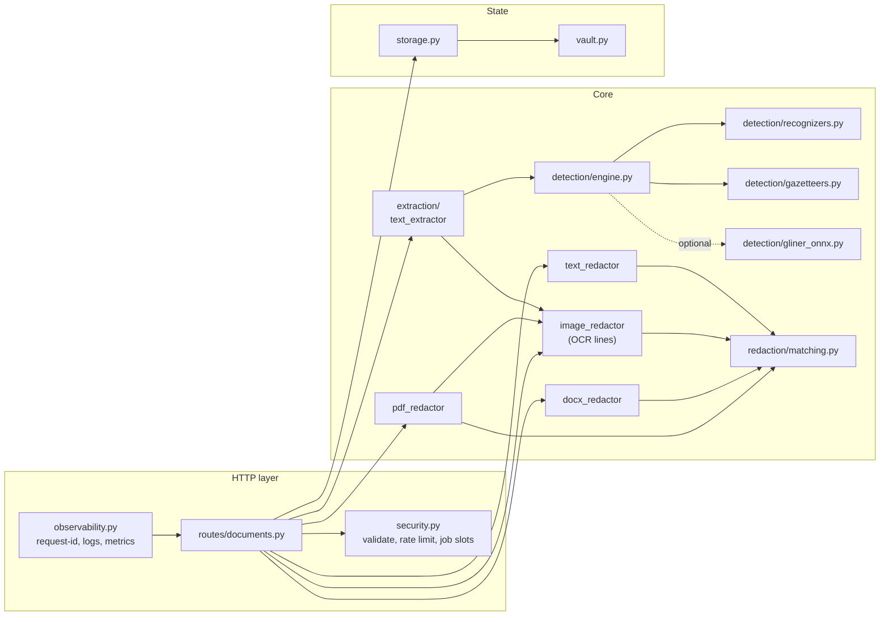

| Module | Responsibility | Notable design point |
|---|---|---|
| `security.py` | Content validation, rate limiting, concurrency cap | All dependency-free and in-process; documented where Redis would replace it |
| `observability.py` | Request IDs, access log, metrics, Sentry | Logs route **templates**, never concrete paths or bodies |
| `vault.py` | Encrypt/decrypt bytes, text, files | Transparent pass-through when no key → zero-migration rollout |
| `storage.py` | SQLite persistence | Column-name allow-list on updates (no SQL injection via keys) |
| `engine.py` | Detection orchestration | All scoring policy lives in one place |
| `matching.py` | Locate entity text in rendered text | Shared by every redactor → identical semantics across formats |

---

## 10. Detection engine (the AI part)

### 10.1 Pipeline

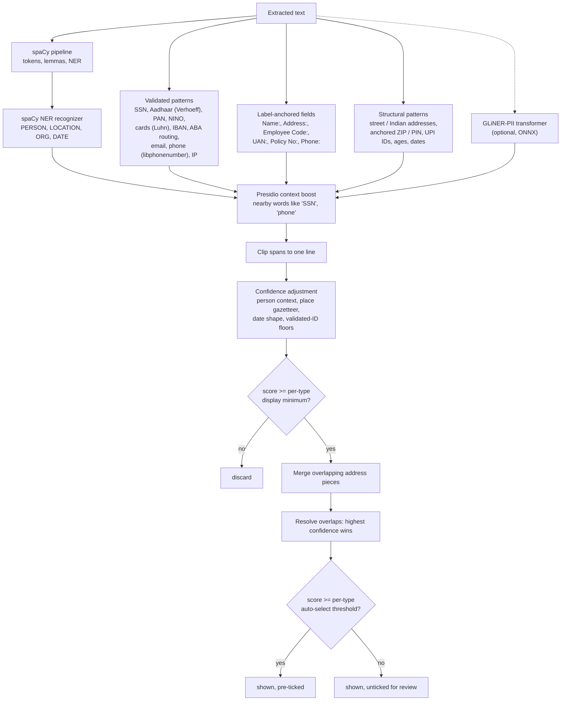

### 10.2 The layers and what each one is for

| Layer | Catches | Strength | Weakness it covers |
|---|---|---|---|
| **Validated patterns** (Presidio built-ins + explicitly registered India/UK recognizers) | Government IDs, cards, bank numbers, email, phone, IP | Checksums → near-zero false positives | Needs a distinctive format |
| **Label-anchored fields** (custom) | Employee codes, UANs, policy numbers, names and addresses in forms | Works for values with **no** format at all, because the label says what it is | Needs a label |
| **Structural patterns** (custom) | Street and Indian addresses, ZIP after state, PIN after city, UPI IDs, ages, textual dates | Deterministic, explainable | Brittle on unusual layouts |
| **spaCy NER** | Names, places, orgs, dates in prose | Context from the sentence | Tags tools as people ("Docker"), countries as PII |
| **GLiNER-PII** (optional) | Names, addresses, IDs in free text | Contextual, PII-specific, precise | Memory and CPU cost |

> **Finding during evaluation:** Presidio ships recognizers for Aadhaar, PAN, GSTIN and UK NINO but **does not load them by default**. The README claimed coverage that didn't exist; Indian government-ID recall was **33%** until they were registered explicitly (now **89%**).

### 10.3 Confidence policy — two thresholds, not one

- **Display minimum (per type):** below it, a candidate is discarded. Kept deliberately low so uncertain guesses are *shown*.
- **Auto-select threshold:** at or above it, the entity is **pre-ticked**. Below it, it is shown **unticked** — the reviewer must opt in.
- Rationale: blacking out text is destructive. A noisy guess should never be applied silently, but should never be hidden either.
- Per-type auto-select thresholds *can* be fitted (`evals/calibrate.py` → `thresholds.json`, loaded only if present). A fit on public dev data was **tried and rejected** (§17.5); the intended source is production reviewer feedback.

### 10.4 Context-aware adjustments (closed vocabularies, not document-specific hacks)

| Rule | Problem it fixes | How |
|---|---|---|
| **Single-word PERSON** is down-weighted… | spaCy tags "Docker", "Streamlit" as people | Multi-word capitalised names keep full score |
| …**unless context says person** | Real names like "Mr. Hayes", "Thanks Rahul", "Cheers,\nMegan" were left unticked | Honorific before, greeting/sign-off before, possessive after, or the word appears in a full name elsewhere in the document |
| **Countries / states / short codes** down-weighted | "United Kingdom", "TX" pre-ticked like a home address | Gazetteer; HIPAA Safe Harbor treats state-level geography as non-identifying |
| **Durations / frequencies / bare years** down-weighted | "7 days", "monthly", "2018" pre-ticked as dates | Regex over the closed vocabulary of time units |
| **Validated-format floors** | Valid phone/NINO left unticked because a context word was missing | Floor score just above auto-select |
| **Address-piece merge** | A full labelled address lost to a higher-scoring sub-span ("Navrangpura"), leaking the flat number | Overlapping address-family spans merge into one ADDRESS |

### 10.5 The optional transformer, built for a 512 MB box

- GLiNER scores spans against **label names given at runtime** ("name", "location address", "ssn"…), so the label set is configuration, not training.
- The official `gliner` package needs **PyTorch** — impossible in 512 MB. Blacken re-implements GLiNER's small pre/post-processing (word splitting, prompt, span/token decoding) on **onnxruntime + tokenizers** directly (`gliner_onnx.py`), supporting both the span head (base) and the token head (small/edge).
- Memory engineering: the CPU memory arena is disabled, it runs single-threaded, and **the transformer loads before spaCy** so onnxruntime's transient double-buffering happens while the process is still small.
- Weights are fetched at build time from a **pinned revision with SHA-256 verification** (`scripts/fetch_pii_model.py`).

---

## 11. Redaction engine

### 11.1 Per-format strategy

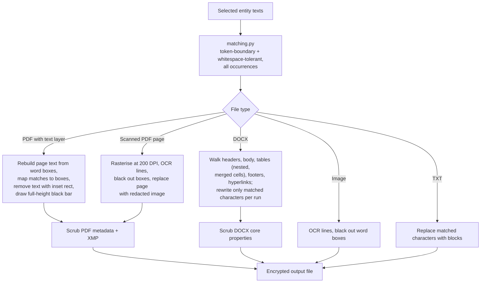

### 11.2 Matching rules (shared by every format)

- **Token boundaries:** a match can't be flanked by a letter or digit, and digits joined by `,` or `.` count as one number. Before this, "52" also blacked out "1,52,400" — **22.8% of non-PII words destroyed on PDFs**; now **1.9%**.
- **Whitespace tolerant:** any whitespace run matches any whitespace run, which also handles entities wrapped across lines in a PDF.
- **All occurrences:** if a name appears three times, all three go — what a reviewer means by "redact this".

### 11.3 Subtle problems solved (good interview material)

| Problem | Symptom | Fix |
|---|---|---|
| PyMuPDF word boxes overlap neighbouring lines | Redacting one line deleted words on the lines above/below | Remove text with a vertically inset rect; draw the visible bar separately as vector art (removes nothing) |
| DOCX tables/headers never visited | **66%** of PII left even with perfect detection | Shared traversal over every part, used by both extraction and redaction |
| lxml proxy `id()` reuse (in the new traversal, pre-release) | Later table rows skipped as "already seen" | Dedupe on element objects, not `id()` (caught by the e2e oracle test) |
| Hyperlinked emails | `paragraph.runs` skips hyperlink runs → emails never redacted | Iterate inner content including hyperlinks |
| OCR text vs redaction text mismatch | Entity found at upload not findable at redact | One OCR line-reconstruction function used by both |
| Empty selection | API returned 500 | Redactors always write a (metadata-scrubbed) output |

---

## 12. Data model and data lifecycle

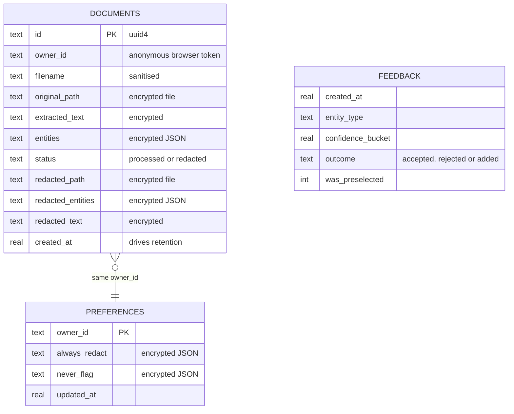

- **FEEDBACK has no foreign key and no text on purpose:** it must outlive documents and never contain PII.
- Uploaded files are stored as `<uuid>.<ext>` — the original filename (which can itself contain a name) never touches the filesystem.

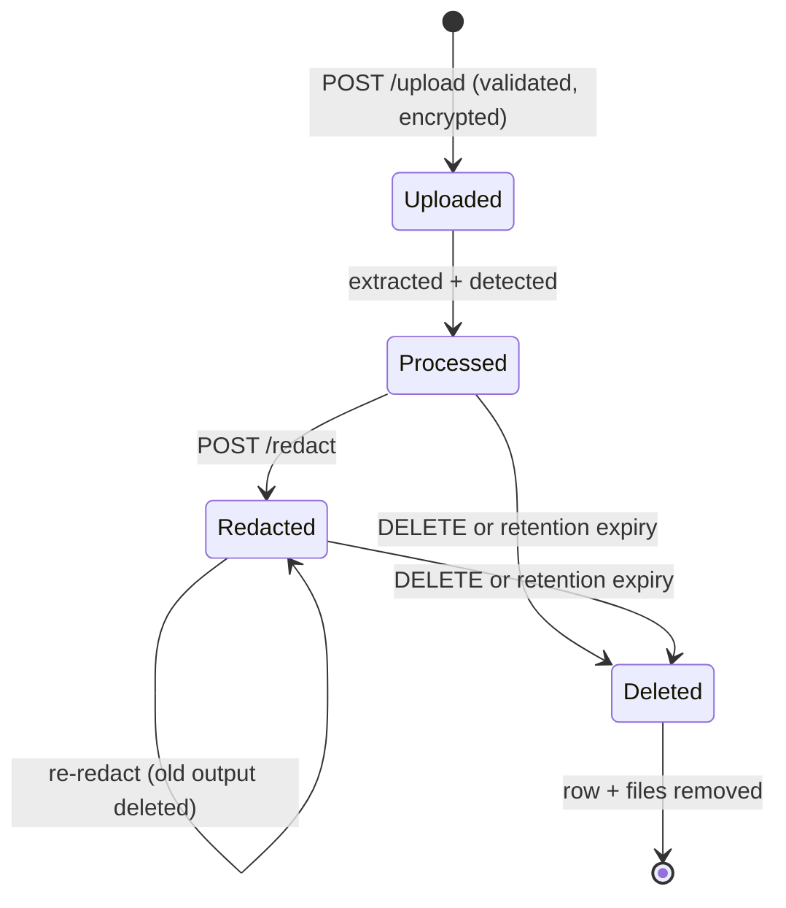

- **Retention:** default 6 hours, swept every 15 minutes and once at startup.

---

## 13. Security and privacy

### 13.1 Threat model

| Threat | Example | Control |
|---|---|---|
| Cross-user data access | One visitor lists another's documents | Every query scoped by owner token; missing/short token → 400. **Found and fixed:** header-less clients previously shared one bucket |
| Unauthorised global change | Visitor sets retention to 30 days for everyone | Admin endpoints need `ADMIN_API_KEY` (constant-time compare); disabled if unset |
| Malicious upload | Renamed executable hits PDF/DOCX parsers | Extension allow-list + magic-byte check + DOCX structure check + size cap; non-root container |
| Data at rest exposure | Disk or DB copied | Fernet encryption of files and PII columns (`DATA_ENCRYPTION_KEY`) |
| Incomplete redaction | Text under the black box, metadata | True content removal; metadata/XMP/core-properties scrub; e2e leakage tests |
| PII in logs/telemetry | Names in logs, Sentry, metrics | Route templates only; no bodies/headers to Sentry; feedback stores type + confidence only; audit logs masked |
| Abuse / DoS | Upload flood, OOM via concurrent OCR | Per-IP + per-owner rate limits; bounded job concurrency with 503 + Retry-After |
| Long-lived data | Old PII accumulating | Short retention + sweeper; explicit delete endpoint |
| Supply chain (models) | Swapped weights upstream | Pinned HF revision + SHA-256 verification |

### 13.2 Trust boundaries

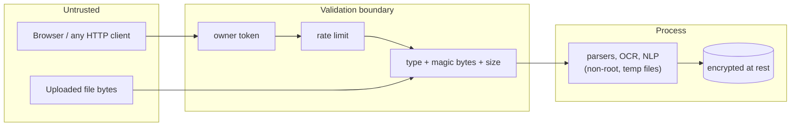

### 13.3 Honest limits of the current model
- The owner token is a **bearer secret in localStorage** — anyone with it sees that browser's documents. Real accounts are the planned upgrade.
- Rate limiting is per process (fine for one instance, needs Redis for several).
- While a job runs, plaintext exists in a temp file and in memory — unavoidable for parsing; minimised by scope.

---

## 14. Performance, memory and capacity

### 14.1 Memory budget (512 MB container, default profile)

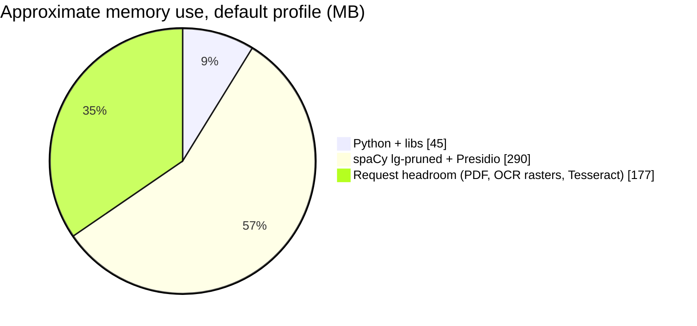

| Detection profile (measured as macOS physical footprint) | Steady | Peak |
|---|---:|---:|
| spaCy lg-pruned + rules (**default**) | 335 MB | 335 MB |
| spaCy lg (full) + rules | 705 MB | 703 MB |
| spaCy sm + rules | 124 MB | 124 MB |
| lg-pruned + rules + GLiNER-edge (**most accurate on gold**) | 410 MB | 431 MB |
| sm + rules + GLiNER-edge (**recommended for 512 MB**) | 179 MB | 215 MB |

### 14.2 Latency (measured)

| Operation | p50 | Notes |
|---|---:|---|
| Detect 500 chars | 12 ms | ~40k chars/s single-threaded |
| Detect 10k chars (~4 pages) | 281 ms | default profile (pruned lg + rules) |
| Detect 50k chars | 2.1 s | |
| Upload → detect → redact → download, 5-page PDF | 577 ms | local, API in-process |
| Scanned page / image (OCR) | ~1 s | Tesseract dominates |
| Live production, upload + detect (server-side) | ~85 ms | GLiNER profile + encryption on, small 1-page PDF; 40/40 calls succeeded |
| Live production, end-to-end p50 | 361 ms upload · 296 ms redact · 261 ms download | measured from a laptop over the internet; ~280 ms of each is network round trip |
| Railway cold start | ~6.3 s | free-tier container wake-up (measured on the earlier deploy) |

### 14.3 Concurrency model
- **Event loop** handles HTTP; **worker threads** do CPU work (`asyncio.to_thread`).
- **Job limiter** (`MAX_CONCURRENT_JOBS`, default 2, use 1 on 512 MB) caps simultaneous heavy jobs. Extra requests wait up to 30 s, then get **503 + Retry-After** — a degraded answer instead of an OOM-killed process taking every request down.
- Python's GIL limits CPU parallelism anyway; the limiter is about **memory**, not throughput.

---

## 15. Reliability and failure modes

| Failure | Detection | Behaviour |
|---|---|---|
| Wrong / missing spaCy model | Startup check | Fails fast with a clear message instead of downloading 560 MB and getting OOM-killed |
| Tesseract missing | `/api/health` `features.ocr=false` | Text-layer formats keep working |
| Corrupt / disguised file | Magic bytes, parser errors | 400 with a specific message; file removed |
| Too many concurrent jobs | Job limiter | 503 + Retry-After; frontend shows "try again in N s" |
| Redactor crash | Exception handler | 500, partial output deleted, error logged with request ID |
| Process restart | — | SQLite + files persist on the volume; retention sweep runs on startup |
| Redeploy on ephemeral disk (Railway) | — | In-flight documents lost; acceptable at a 6-hour retention (§21 adds object storage) |
| Corrupt thresholds file | Load-time check | Ignored with a warning; global default used |

---

## 16. Observability and the quality feedback loop

- **Request IDs** on every response (`X-Request-ID`; honoured if the client sends one).
- **Structured access logs** (`LOG_FORMAT=json`): method, route template, status, latency.
- **Prometheus metrics** at `/api/admin/metrics`: request counts and latency histograms per route, documents processed/redacted per format, entities detected per type, active/waiting jobs.
- **Sentry** (optional) with request bodies, headers and query strings stripped.

### Measuring real-world precision without collecting PII

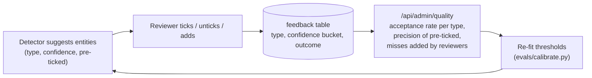

- **Precision of pre-ticked** = share of pre-ticked entities reviewers kept → live precision per type.
- **Added by reviewer** = misses a human caught → a live recall signal.
- No entity text is ever stored, so the loop is privacy-safe by construction.

---

## 17. Evaluation framework and results

### 17.1 Harness

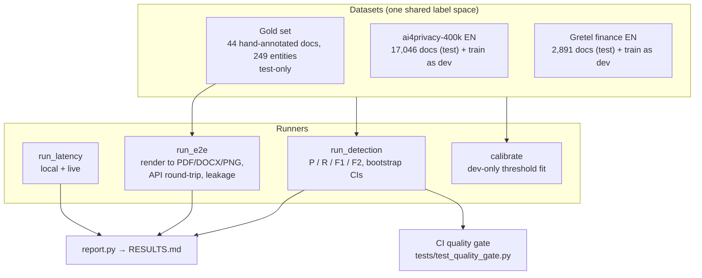

### 17.2 Metrics and why
- **Token-level recall/precision (headline):** fraction of PII tokens blacked out — the closest proxy for leakage.
- **Entity overlap and full-coverage recall:** was each item flagged at all, and was *all* of it covered?
- **Strict F1:** exact span + type, seqeval-style, for comparability with NER literature.
- **F2:** recall weighted 2× — a leak costs more than a false alarm.
- **95% CIs:** document-level bootstrap (errors within a document are correlated).
- **Two operating points:** *detected* (what the reviewer sees) and *auto* (what one-click Redact removes).
- **E2E leakage:** what an adversary can extract from the output file (text layer, all DOCX XML, metadata, OCR); plus an **oracle** mode that feeds gold entities straight to the redactor, isolating redaction bugs from detection misses.

### 17.3 Results (auto-selected, i.e. default one-click redaction)

| Test set | Recall before → after | Precision before → after | F2 before → after |
|---|---:|---:|---:|
| Gold set (44 docs) | 75.8% → **93.7%** | 93.3% → **96.5%** | 78.7% → **94.2%** |
| ai4privacy (17,046 docs) | 52.4% → **59.3%** | 38.2% → **40.3%** | 48.8% → **54.2%** |
| Gretel finance (2,891 docs) | 62.1% → **69.1%** | 39.5% → **42.9%** | 55.7% → **61.6%** |

| Output format | PII leak before → after | Redactor-only leak (oracle) | False redactions | Metadata leaks |
|---|---:|---:|---:|---:|
| PDF | 18.5% → **10.4%** | 0.4% → **0.0%** | 22.8% → **1.9%** | 31 → **0** |
| Scanned PDF | 26.6% → **10.0%** | 1.7% → 1.7% | 5.0% → 4.7% | 0 → 0 |
| DOCX | 27.7% → **9.2%** | 0.0% → 0.0% | 2.6% → 1.4% | 32 → **0** |
| DOCX with tables/headers | 74.3% → **9.2%** | 66.3% → **0.0%** | 1.5% → 1.5% | 32 → **0** |
| PNG | 29.8% → **10.7%** | 2.5% → 2.5% | 5.1% → 5.0% | 0 → 0 |

### 17.4 Model configurations (dev splits, 1,000 docs each, + gold)

| Configuration | ai4privacy recall | Gretel recall | Gold recall / precision | Memory peak |
|---|---:|---:|---:|---:|
| lg-pruned + rules (default) | 60.0% | 67.9% | 93.7% / 96.5% | 335 MB |
| full lg + rules | 62.3% | 71.9% | 93.5% / 97.3% | 703 MB |
| sm + rules | 62.7% | 71.2% | 89.9% / 94.8% | 124 MB |
| lg-pruned + rules + GLiNER-edge | 65.7% | 69.8% | **95.1% / 96.5%** | 431 MB |
| **sm + rules + GLiNER-edge** | **68.4%** | **73.7%** | 91.1% / 94.8% | **215 MB** |
| sm (no NER) + rules + GLiNER-edge | 54.3% | 53.6% | 85.2% / 97.8% | 245 MB |

**Takeaways**
- GLiNER-edge **complements** spaCy but **doesn't replace** it: removing spaCy's NER loses 8–14 recall points.
- **Best recall that fits 512 MB:** `sm` + rules + GLiNER-edge — on the full held-out test splits it gains **+6.5 / +5.4 points** of token recall over the default (ai4privacy 59.3% → 65.8%, Gretel 69.1% → 74.5%; the dev-sample estimate of +8.4 / +5.8 was optimistic) at *less* memory (215 MB vs 335 MB). Cost: more false alarms (gold precision 94.8% vs 96.5%; pre-ticked false alarms on 33% vs 25% of PII-free documents).
- **Best on the fully annotated gold set:** pruned `lg` + GLiNER-edge (95.1% recall, 96.5% precision) — needs ~1 GB to run comfortably.
- Pruned vs full `lg` is **not free**: ~2–4 recall points on public sets, for ~370 MB saved.
- Speed cost of the transformer: ~0.4 s → ~3.2 s per 10k characters (measured on arm64; x86 int8 is typically faster).

### 17.5 Experiments that were measured and rejected

| Experiment | Result | Decision |
|---|---|---|
| **Per-type thresholds fitted on public dev data** (`evals/calibrate.py`) | Public test F2 up (54.2 → 59.0, 61.6 → 64.7), but **gold recall 93.7% → 89.4%** | **Rejected.** The fit learned the datasets' label gaps (e.g. dates pushed to 0.85 because Gretel rarely labels them). Kept the tool; the right data is production reviewer feedback (§16) |
| **300 DPI OCR** (vs 200) | Scanned-PDF leak 10.0% → 11.2%, oracle 1.7% → 3.3%, slower, 2.25× memory per page | **Rejected.** Shipped 200 DPI; kept grayscale + autocontrast preprocessing and low-confidence words (PNG leak 10.7% → 9.9%, oracle 2.5% → 1.7%) |
| **Transformer replacing spaCy NER** (`USE_SPACY_NER=false`) | Recall 54% / 54% / 85% | **Rejected** as a default; switch kept for experimentation |

### 17.6 Caveats (stated up front, as in the results file)
- Public-set **precision is a lower bound** — those datasets leave real PII unlabelled. Quote recall from public sets, precision from the gold set.
- The gold set was written by the same team that tuned the rules; treat it as a strong regression suite. Public **test** splits were never used for tuning.
- ai4privacy contains structurally invalid values (e.g. impossible phone numbers); Blacken validates phones by design and scores lower there.

---

## 18. Key design decisions (ADR log)

Each decision: context → decision → alternatives → consequences.

**ADR-1 · Local open-source PII stack instead of a cloud PII/LLM API**
- *Context:* documents are exactly the data users can't send to third parties; budget is zero.
- *Decision:* Presidio + spaCy (+ optional ONNX transformer), all in-process.
- *Alternatives:* AWS Comprehend / Google DLP / LLM prompting — better recall on some types, but data egress, per-page cost, latency, non-determinism.
- *Consequences:* privacy and cost win; accuracy has to be earned with engineering and measured honestly.

**ADR-2 · Layered ensemble rather than one model**
- *Decision:* validators + label-anchored rules + statistical NER (+ transformer).
- *Why:* each layer covers another's blind spot — checksums for IDs, labels for format-less values, models for prose.
- *Consequence:* more components to reason about; mitigated by keeping all scoring policy in `engine.py` and measuring each layer's contribution.

**ADR-3 · Two-threshold confidence (show vs pre-tick)**
- *Why:* redaction is destructive; uncertainty should go to the human, not be applied or hidden.
- *Consequence:* the "auto" operating point is the metric that matters; UI shows more items than it pre-selects.

**ADR-4 · Pruned `en_core_web_lg`**
- *Why:* full `lg` (~705 MB) can't fit 512 MB with request headroom; `sm` was measurably worse on the gold set.
- *Trade-off:* ~2–4 recall points on public sets, now documented rather than claimed to be zero.

**ADR-5 · Optional transformer via ONNX, without PyTorch**
- *Why:* PyTorch alone exceeds the memory budget; GLiNER's pre/post-processing is small enough to own.
- *Consequence:* ~150 lines of model-specific code to maintain; a 46 MB model. Paired with the small spaCy pipeline it gives the best measured recall on public data (held-out: +6.5 pts on ai4privacy) at 215 MB.
- *Off by default* (no model download needed); enabled via a build arg + two env vars.

**ADR-6 · Redact all boundary-respecting occurrences of the selected text**
- *Alternative:* redact only the exact detected offset — fragile, because extraction text and render text differ per format.
- *Consequence:* consistent redaction across repeats; boundary rules keep collateral damage at 1.9%.

**ADR-7 · Anonymous owner token instead of accounts**
- *Why:* zero-friction tool, no PII collected about users themselves.
- *Consequence:* isolation is only as strong as the token; accounts are the documented next step.

**ADR-8 · SQLite + local disk**
- *Why:* hours-long retention, single instance, zero-ops.
- *Trade-off:* no horizontal scale, data lost on redeploy with ephemeral disks; object storage is the scale-out path.

**ADR-9 · Encryption at rest with Fernet, opt-in by env**
- *Why:* the DB holds the most sensitive data in the system (extracted text + found PII).
- *Consequence:* small CPU cost; transparent plaintext pass-through means enabling it needs no migration.

**ADR-10 · Bounded concurrency + 503 instead of a job queue**
- *Why:* a queue (Celery/RQ + Redis) is a second service the free tier can't afford; the real risk is memory, not throughput.
- *Consequence:* simple and safe now; a queue becomes worthwhile with multiple workers.

**ADR-11 · Synchronous API (request waits for the result)**
- *Why:* typical documents finish in under a second or two; the frontend is simpler.
- *Consequence:* very large scans hold a request open; async jobs with polling are on the roadmap.

**ADR-12 · Evaluation as a first-class component**
- *Why:* "AI-powered" claims without numbers are unfalsifiable; the harness surfaced real production bugs (§23 war stories).
- *Consequence:* every change can be judged by recall/precision/leakage deltas; CI blocks regressions.

**ADR-13 · Privacy-safe telemetry**
- *Decision:* metrics and feedback store types, buckets, counts — never values.
- *Consequence:* real-world precision is measurable without becoming a PII store yourself.

**ADR-14 · Reject threshold calibration on public data**
- *Context:* fitted per-type thresholds improved public-set F2 but lowered gold-set recall by 4.3 points.
- *Decision:* trust the only fully annotated set; don't ship. Recalibrate later from reviewer feedback, which has no label gaps.
- *Lesson:* an optimiser will happily learn your dataset's annotation holes — a guard set with complete labels is what catches it.

**ADR-15 · 512 MB profile = small spaCy + GLiNER-edge**
- *Context:* the pruned-`lg` + GLiNER combination is best on the gold set but peaks at ~431 MB, leaving too little headroom for OCR on 512 MB.
- *Decision:* recommend `sm` + rules + GLiNER-edge for the free tier (215 MB, best public recall); pruned-`lg` + GLiNER for ≥ 1 GB.
- *Trade-off:* a few more false alarms in exchange for recall and a large memory safety margin.

---

## 19. Trade-offs at a glance

| Dimension | Chose | Gave up | Why acceptable |
|---|---|---|---|
| Recall vs precision | Recall (F2, low display threshold) | Some false alarms | Reviewer unticks cheaply; leaks are irreversible |
| Accuracy vs memory | Pruned lg, transformer optional | 2–6 recall points on the free tier | Configurable per host; measured, not hidden |
| Privacy vs capability | Local inference | Cloud-API recall | Core product promise |
| Simplicity vs scale | Single process, SQLite, in-memory limits | Horizontal scaling | Free tier is one instance; scale-out path documented |
| UX vs safety | Human review step | One-click full automation | Destructive action needs a human |
| Speed vs thoroughness | 300 DPI OCR, all-occurrence matching | ~1 s per scanned page | Correctness beats latency for this task |
| Identity vs friction | Anonymous token | Cross-device history, strong auth | Planned extension |

---

## 20. Deployment, configuration and CI

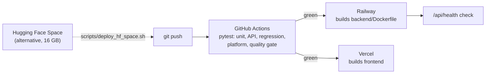

### Profiles

| Profile | Build | Runtime env | Use when |
|---|---|---|---|
| **Default** | `docker build .` | `SPACY_MODEL=/app/models/en_core_web_lg_pruned` | Any host; no model download (335 MB) |
| **Best recall on 512 MB** (recommended for Railway free) | `--build-arg PII_PROFILE=edge` | `PII_MODEL_DIR=/app/models/gliner-pii-edge`, `SPACY_MODEL=en_core_web_sm`, `MAX_CONCURRENT_JOBS=1` | Railway free (215 MB) |
| **Best on gold** | `--build-arg PII_PROFILE=edge` | `PII_MODEL_DIR=/app/models/gliner-pii-edge` (keep pruned `lg`) | ≥ 1 GB (431 MB peak) |
| **Max accuracy** | HF Space script | full `en_core_web_lg` + GLiNER | 16 GB Space |

### Essential production settings
- `DATA_ENCRYPTION_KEY` — enable encryption at rest.
- `ADMIN_API_KEY` — enable admin endpoints (quality, metrics, config).
- `CORS_ORIGINS` — the frontend's exact origin.
- `MAX_CONCURRENT_JOBS=1` on 512 MB.
- `LOG_FORMAT=json`, `SENTRY_DSN` (optional).

Full list: `backend/README.md` → Configuration.

---

## 21. Scaling roadmap

| Scale | What breaks first | Change |
|---|---|---|
| **Today** (1 instance, hobby traffic) | Memory on large scans | Job limiter (done) |
| **10×** (sustained traffic) | Single CPU, request-held jobs | Async jobs: upload returns `job_id`, worker processes, client polls / SSE; bigger instance; enable transformer |
| **100×** (multiple instances) | SQLite, local disk, in-process rate limits | Postgres; S3/R2 with lifecycle expiry + SSE-KMS; Redis for rate limits and job queue; stateless API replicas behind a load balancer |
| **Enterprise** | Identity, compliance | SSO/accounts, per-tenant keys (envelope encryption), audit export, data-residency regions, model serving as a separate autoscaled service |

---

## 22. Known limitations

- English-first detection; non-English names and addresses are weaker.
- Remaining leak rate ≈ 9–11% in output files is **detection misses** (text-layer redaction itself is 0% in oracle tests): mainly bare city names, unusual ID formats, single-token names without context.
- OCR quality bounds scans and photos (1.7–2.5% leak even with perfect detection).
- Entities that span a line break in extracted text are clipped to one line by design (prevents header/next-line merges) — a wrapped name can be partially caught.
- DOCX page previews aren't rendered (no layout engine); a text preview is shown instead.
- Owner token is a bearer secret; no accounts yet.

---

## 23. Interview guide

### 60-second pitch
> "Blacken is a privacy-first document redaction platform. It detects PII in PDFs, scans, Word files and images using a layered ensemble — checksum validators, label-anchored rules, spaCy NER and an optional GLiNER transformer I run on ONNX without PyTorch so it fits a 512 MB container. A human reviews the suggestions, then format-specific redactors physically remove the text and scrub metadata. I built an evaluation harness over 20,000 documents plus an end-to-end leakage test, which took recall from 76% to 94% at 96.5% precision and cut PII left in redacted Word forms from 74% to 9%."

### Two-minute deep dive (pick one thread)
1. **Measurement found the real bugs:** the oracle mode (feeding perfect entities to the redactor) proved DOCX tables were never visited — 66% leak with perfect detection. That's not a model problem, it's a traversal bug no accuracy metric would show.
2. **Memory engineering:** PyTorch doesn't fit; I re-implemented GLiNER's decoding on onnxruntime, load it before spaCy to keep the peak down, and measured physical footprint because macOS RSS hides compressed pages (it understated full spaCy by 2×).
3. **Saying no with data:** per-type thresholds fitted on dev data looked great on public test sets but cut gold-set recall by 4.3 points — the optimiser had learned the datasets' missing labels. Rejected; the tool now waits for label-gap-free production feedback.

### Likely questions and strong answers
- **Why not just use an LLM?** Data egress is the product's core constraint; LLMs are also non-deterministic, slow per page and costly. An LLM could be an *offline* labeller to grow training data — not in the request path.
- **How do you know it works?** Token-level recall/precision with bootstrap CIs on public benchmarks (recall) and a fully annotated gold set (precision), plus an end-to-end test that reads back the output files. CI fails if gold-set recall regresses.
- **Why F2?** Asymmetric cost: a leaked SSN is irreversible, an extra bar is one click to undo.
- **How do you avoid overfitting your own test set?** Tune only on public *train* splits; public *test* splits never inform tuning; gold set treated as regression, with that caveat stated in the results.
- **How would you scale it?** Async jobs + worker pool, Postgres, object storage, Redis for limits/queue, model as a separate service — the in-process pieces are already isolated behind small interfaces.
- **What's the biggest remaining risk?** Detection misses on context-free single tokens (a lone city name). Levers: the GLiNER profile (already +5–8 recall points), then threshold refits from reviewer feedback.
- **How is user data protected?** Owner-scoped queries, encryption at rest, short retention, metadata scrubbing, masked audit logs, PII-free telemetry, non-root container, validated uploads, rate limits.
- **What would you do differently?** Build the evaluation harness first — it surfaced the cross-tenant bug, the missing Indian ID recognizers and the DOCX traversal bug, none of which a single accuracy number would have shown.

### War stories (bugs found by the harness)
1. **Shared anonymous bucket** — clients without an owner header all wrote to and listed one bucket.
2. **Advertised ≠ loaded** — Aadhaar/PAN/NINO recognizers existed in Presidio but were never registered (GOV_ID recall 33%).
3. **DOCX blind spots** — tables, headers and hyperlinks skipped: 66% leak with perfect detection.
4. **`id()` reuse (caught in my own fix)** — the first version of the new DOCX table traversal deduped cells by Python `id()` of lxml proxies; ids are reused after garbage collection, so later rows were silently skipped. The e2e oracle test caught it before it shipped.
5. **Neighbour-line deletion** — PDF redaction boxes deleted words on adjacent lines; substring matching blacked out 22.8% of non-PII words.
6. **Metric artifact** — RSS on macOS understated memory 2×; switched to physical footprint before making a deployment decision.

### Numbers cheat sheet
- Gold set: **93.7% recall / 96.5% precision / 94.2% F2** (CI on recall 89.7–97.2).
- Public: ai4privacy recall **59.3%** (+6.9 pts), Gretel **69.1%** (+7.0 pts).
- Leakage: DOCX forms **74.3% → 9.2%**, PDF **18.5% → 10.4%**, false redactions **22.8% → 1.9%**, metadata **100% → 0%**.
- Transformer (GLiNER-edge, 46 MB int8 ONNX): with pruned `lg` **+5.7 pts** ai4privacy recall and **+1.4** on gold; with small spaCy **+6.5 / +5.4 pts** on the held-out public test splits (65.8% / 74.5% recall) at **215 MB** total; gold recall 91.1% (−2.6 pts), leakage unchanged at 8.8–10.8% across formats.
- Rejected with evidence: dev-fitted thresholds (gold recall −4.3 pts), 300 DPI OCR (no gain, 2.25× memory).
- Speed: **~40k chars/s**, 5-page PDF round trip **~0.6 s**, live server-side **~85 ms** with the transformer on (0 errors).
- Scale of evaluation: **~20k documents, ~27k entities**.

---

## 24. Glossary

| Term | Meaning |
|---|---|
| PII | Personally identifiable information |
| Recall | Share of real PII that was caught |
| Precision | Share of flagged items that really were PII |
| F2 | Harmonic mean weighting recall 2× over precision |
| Auto-select / pre-tick | Entity selected for redaction by default |
| Oracle mode | E2E test feeding gold entities to the redactor, isolating redaction bugs |
| NER | Named-entity recognition |
| GLiNER | Generalist span-based NER model that takes label names as input |
| ONNX / onnxruntime | Portable model format / lightweight inference runtime |
| Presidio | Microsoft's open-source PII detection framework |
| Fernet | Authenticated symmetric encryption scheme (`cryptography`) |
| Magic bytes | Leading file bytes identifying the real file type |
| Physical footprint | macOS memory metric including compressed pages (≈ Linux RSS) |
| HIPAA Safe Harbor | US de-identification standard listing 18 identifier types |
